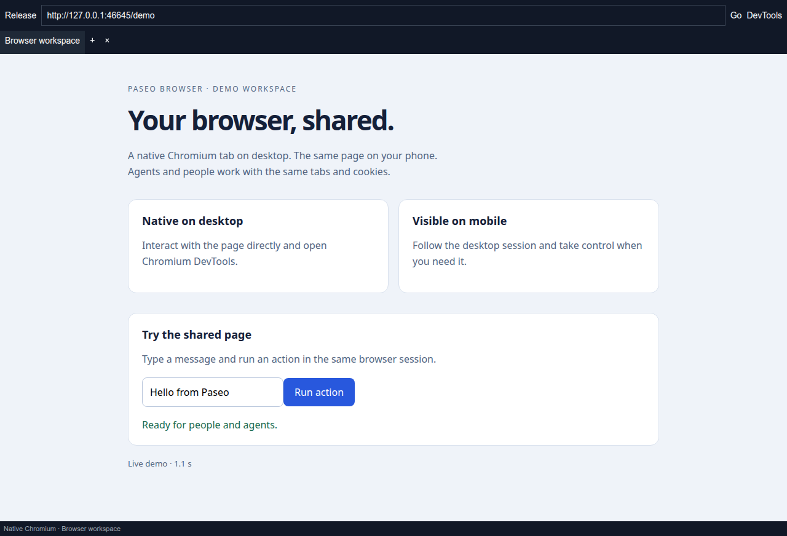

# Paseo Browser

Native Chromium in Paseo Desktop, with a live mobile broadcast of the same browser session. Agents and people use the same tabs, cookies and page state.



## Install

Install from the official catalog on your Paseo daemon:

```sh
paseo plugin add js2me/browser
```

Requires **Paseo 0.15.0+**, **Node.js 24+** and plugins enabled on the target daemon.
The catalog installs its reviewed commit. Direct Git installation with
`paseo plugin add git:js2me/paseo-browser` follows the repository separately.

**Native rendering, desktop DevTools and mobile viewing work with standard Paseo Desktop.**
Mobile viewing uses its built-in screenshot API on older Desktop builds.
The built-in Desktop DevTools API adds faster capture and full CDP, including HttpOnly cookie management.
See [Desktop support](#desktop-devtools-support).

## Native desktop and mobile

The default `hybrid` mode embeds an actual Electron WebView in the workspace panel. Desktop rendering, keyboard, mouse and scrolling run in Chromium. Mobile and browser clients receive MJPEG frames from that exact guest through authenticated Paseo plugin RPCs. The desktop remains the browser host; websites and `localhost` URLs run on that desktop.

The mobile viewer retains its last decoded frame while the next JPEG loads, with Android image fading disabled. Remote capture starts only when a viewer is watching. It publishes the latest frame with no playback backlog and bounds frames to 1280 × 960 at JPEG quality 65. Standard desktop capture is limited to five requests per second, with one capture in flight. With the built-in Desktop DevTools API, capture requests approximately 15 updates per second, with a bounded CDP still fallback for static pages. Closing the desktop panel parks its native guests without destroying them, so mobile viewing can continue. The desktop application must remain connected. Requests from an agent or mobile viewer start the native browser even when that workspace panel has never been opened on desktop. iOS and Android use their native image component for the JPEG stream. Desktop always displays the actual WebView in hybrid mode, including when the bridge is absent.

Each workspace supports eight native tabs. Take and release control to pass the browser between a person and agents. Native agent tools wait for an in-flight command before a human takeover and reject commands whose lease changed. Dispatched mutations are never automatically retried. Mobile taps target the desktop viewport; the text controls send input to the focused page field.

On desktop, take control and click **DevTools** to open Chromium's developer tools for the selected tab in a separate window, including Elements, Console, Network, Sources and Application.

Native tabs use `persist:paseo-browser`, the same profile as Paseo's built-in browser. Cookies and logins are shared across native workspace tabs. This is independent of the legacy daemon Chrome profiles.

## Desktop DevTools support

Full native DevTools access is integrated into Paseo Desktop through its browser API (`nativeBridgeVersion: 1`, `sendNativeCommand`, `readNativeEvents`, `captureNativeFrame`). The plugin detects it automatically. Users install the plugin and use a Desktop release containing this API; no application copying, ASAR patching or additional browser is required.

The integration is prepared in the Paseo source checkout and must ship in a Desktop release before this is available to all users. The plugin cannot add Electron main-process APIs to an older running Desktop. Older builds continue to support navigation, snapshots, screenshots, JavaScript and HTML/computed-style inspection. CDP-only operations report that Desktop needs an update.

The files under `integrations/paseo/` are developer integration artifacts, not end-user setup instructions.

## Agent tools

Native mode injects the `paseo-browser` MCP adapter:

- `native_browser_open`, `shared_browser_status`, control acquire/release, navigation and native tab tools.
- `native_browser_automation` for snapshots, click/fill/type, keyboard, wait, screenshot, upload/select, hover/drag, console/network logs, scrolling and resizing.
- `evaluate_script` for page JavaScript.
- `browser_cookies` for import/export, setting, deletion and clearing, including HttpOnly/Secure attributes.
- `cdp_send` and `cdp_events` for guest CDP domains and bounded protocol events.

Acquire control before actions and release afterward. `native_browser_automation` takes `{ name, args }`; use element refs from its current `snapshot`. Native browser IDs come from `shared_browser_tabs`. Browser-level commands cannot close or crash Paseo; manage native tabs through the dedicated tab tools. Cookie and protocol rules are enforced by Chromium. Native CDP is scoped to the registered guest and its owning window/workspace. Uploads use the desktop's filesystem and Paseo's workspace path checks.

Installation writes runtime adapters under `$PASEO_HOME/plugin-data/paseo-browser/`. The managed skill under `agent-skills/paseo-browser` is installed into the local agent skill directories. Existing agent sessions need reloading to discover the native adapter. The skill is scoped to live page interaction, not code-only work or plugin configuration. Browser tools remain available without modifying agent system prompts. Existing chats can retain instructions loaded before this update. Unrelated MCP servers and user prompts are preserved.

## Other connection modes

| Mode | Browser and viewing |
| --- | --- |
| `hybrid` | Native desktop WebView; same guest broadcast to mobile. Default for new settings. |
| `workspace` | Legacy persistent Chrome on the daemon, viewed as a stream on every client. 11 shared tools plus 35 DevTools tools. |
| `isolated` | Independent Chrome per agent, visible or headless. |
| `autoConnect` | Personal Chrome 144+ with remote debugging enabled and its connection approved. |
| `endpoint` | An existing Chrome debugging endpoint. |

Legacy workspace cookies and localStorage remain under `$PASEO_HOME/plugin-data/paseo-browser/profiles/`. Chrome MCP usage statistics and CrUX reporting are disabled. Legacy code and its MIT attribution remain in [THIRD_PARTY_LICENSES.md](THIRD_PARTY_LICENSES.md).

## Optional legacy browser setup

Normal preparation reuses installed Chrome and **does not download a browser**. Native mode
uses Electron's included Chromium. If Chrome is absent, native adapters still prepare successfully.
For legacy `workspace` mode, install Chrome yourself and rerun preparation, or set
`PASEO_BROWSER_WORKSPACE_CHROMIUM_EXECUTABLE` to its absolute path before installing the plugin.
Linux ARM64 requires a native, non-Snap Chromium installation.

To explicitly request the optional Chrome for Testing download, run this from the plugin checkout:

```sh
npm run prepare:workspace -- --download-chromium
```

This invokes the locked agent-browser installer, which obtains Chrome for Testing from Google's
distribution. It uses the daemon host's network and disk. Declining this optional step leaves the
browser uninstalled. The flag is not present in the automatic installation commands.

## Data and permissions

This is a trusted local plugin with browser and filesystem access. Native pages and uploads run
on the desktop; legacy workspace pages run on the daemon. Websites receive normal browser requests
and cookies. Information requested by an agent, including page text, screenshots, cookies and
network/console output, can be sent to its configured model provider. Native logins are shared
across Paseo browser workspaces. See [the listing overview](OVERVIEW.md) for storage and access details.

## Development and validation

```sh
npm ci --ignore-scripts
node server/prepare.mjs
npm run typecheck
```

For runtime preparation in development, point `PASEO_HOME` at a dedicated test directory before
running `npm run prepare:workspace`. Install a local checkout with
`paseo plugin install /absolute/path/to/paseo-browser` and reload it after edits.

Run checks appropriate to your change:

```sh
npm run typecheck
npm test
npm run test:shared
npm run test:ui
PASEO_ELECTRON_BINARY=/path/to/electron npm run test:native
```

The native integration test uses a separate Electron process and profile, real WebViews and CDP, a real MCP adapter, and a phone-sized Chrome client. It checks native snapshots/screenshots/tabs, HttpOnly cookies, mobile touch, lease fencing, and fresh frames while the desktop pane is parked. Set `PASEO_CHECKOUT` to the Paseo source checkout containing the bridge patch; it defaults to `../paseo`. This validates a compact web client, not physical iOS/Android hardware.

`test:shared` and `test:ui` cover the retained legacy browser mode. Generated runtimes, local machine paths, node_modules and test artifacts are excluded from the
package or Git. The listing screenshots in `assets/` are intentionally shipped.

Regenerate listing media using an installed Electron executable:

```sh
PASEO_ELECTRON_BINARY=/path/to/electron npx tsx tests/listing-media.ts
```

This uses a private Xvfb display, temporary profiles and the real plugin panel and capture bridge.
It requires Linux, Xvfb and Chrome (or `PASEO_CHROME_BINARY`).

## Publication and contributions

[Registry submission details](.github/REGISTRY_SUBMISSION.md) include the source, screenshots and
bridge requirements. Registry approval is separate from pushing code to GitHub.
Report bugs through [GitHub Issues](https://github.com/js2me/paseo-browser/issues); include the Paseo
versions, operating system, browser mode and reproduction steps. Remove cookies, tokens and
personal page content from logs and screenshots.

Licensed under [MIT](LICENSE). Shared Browser attribution is in
[THIRD_PARTY_LICENSES.md](THIRD_PARTY_LICENSES.md); the desktop integration retains Paseo's licenses.

Agents can also use `browser_storage` for local and session storage, `browser_dialog` to answer JavaScript dialogs, `browser_emulate` for device metrics, timezone, location and media preferences, and `browser_network` for offline mode, throttling, headers, cache and URL blocking. Workspace mode requires a page CDP target ID; native mode uses the selected tab and requires the built-in Desktop DevTools API for dialog, emulation and network operations. These tools respect the existing control lease.

`browser_inspect` reads element HTML, attributes, computed CSS and geometry by CSS selector, including pseudo-element styles, without the native desktop bridge. `browser_dom` exposes the DevTools document tree, queries, box model and live DOM editing. `browser_css` reads matched/inherited rules, computed and inline styles, stylesheet sources and supports live CSS edits and forced hover/focus states. The latter two require the Desktop DevTools API in native mode. General CDP commands and events remain available for Network, Debugger, Performance, Profiler and Accessibility. Live edits do not change source files.
